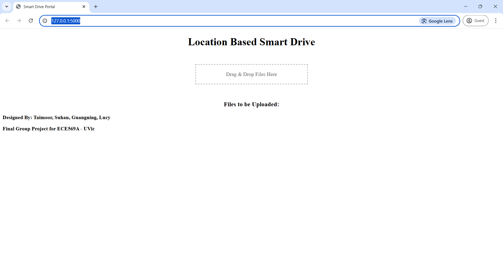

# Location-Based Data Ingestion and Pipeline Simulation

**Team application/course project | October-December 2024 | ECE569A, University of Victoria**

A Python/Flask prototype, originally presented as **A Location Based Smart Drive**, that uploads files to Amazon S3 under a city-based prefix. The HTML/CSS/JavaScript portal requests browser coordinates, OpenCage reverse geocoding identifies the city, and users can enter a city manually when location access or geocoding is unavailable.



## Team contributions

The [team presentation](docs/team_presentation.pdf), slide 14, assigns the following responsibilities:

| Team member | Documented contribution |
| --- | --- |
| Taimoor Shahzad | System design and architecture; implementation of the portal, AWS integration, drag-and-drop uploads, and automation. |
| Suhan Yoon | Project background, technology research, and market analysis. |
| Guangning Li | Data safety and security considerations. |
| Lucy Blecha | Testing plan, test cases, and results. |

The application is a team project. The roles above describe the contributions documented in the presentation.

## How it works

1. Drag one or more files into the portal.
2. Allow browser location access to send coordinates to the Flask backend.
3. The backend calls OpenCage to find the city. If coordinates, an API key, or a geocoding result are unavailable, the portal prompts for manual city input.
4. The backend uploads each file to the configured S3 bucket using an object key such as `Victoria/report.pdf`.

S3 displays these prefixes as folders; the application does not create separate filesystem directories in S3. City names and filenames are normalized, so spaces become underscores and path separators are removed. Uploading the same filename to the same city prefix uses the same object key and can replace an existing object, subject to the bucket's versioning configuration.

## Local setup

Use Python 3.10 or newer. From the repository folder, create a virtual environment and install the dependencies.

Windows PowerShell:

```powershell
python -m venv .venv
.\.venv\Scripts\python.exe -m pip install -r requirements.txt
Copy-Item .env.example .env
```

macOS/Linux:

```bash
python3 -m venv .venv
.venv/bin/python -m pip install -r requirements.txt
cp .env.example .env
```

Edit your local `.env`:

| Setting | Purpose |
| --- | --- |
| `S3_BUCKET` | Your existing S3 bucket name. The application does not create a bucket. |
| `AWS_REGION` | The bucket region; defaults to `us-east-2`. |
| `OPENCAGE_API_KEY` | Your OpenCage API key. Leave blank to use the manual-city path. |
| AWS credentials | Use a local AWS profile, environment credentials, or an IAM role through [Boto3's credential provider chain](https://docs.aws.amazon.com/boto3/latest/guide/credentials.html). The configured identity needs `s3:PutObject` permission for the destination prefix. |

The repository contains no usable AWS or OpenCage credentials. `.env`, AWS credential folders, and the virtual environment are excluded from Git. The original source files contain the supplied `KEY_REMOVED_FOR_SECURITY` placeholders.

Start the local server on Windows:

```powershell
.\.venv\Scripts\python.exe -m flask --app app run
```

On macOS/Linux, use `.venv/bin/python -m flask --app app run`. Open [http://127.0.0.1:5000](http://127.0.0.1:5000). Flask loads the local `.env` through the included python-dotenv dependency. The portal opens without cloud credentials, but successful uploads require your S3 configuration. OpenCage is used only for automatic location lookup.

## Files and original project materials

| Path | Contents |
| --- | --- |
| `app.py` | Runnable Flask backend with environment-based configuration. |
| `templates/index.html` | The portal template; its original layout and team credits are retained. |
| `static/upload.js` | Drag-and-drop, browser geolocation, manual-city fallback, and upload feedback. |
| `.env.example` | Configuration names with empty credential fields. |
| [Project report](docs/project_report.pdf) | Original four-page design and implementation report. |
| [Team presentation](docs/team_presentation.pdf) | Original fifteen-slide presentation, including contribution assignments. |
| [Screenshots](docs/screenshots) | Fifteen original screenshots documenting automatic and manual uploads. |
| `docs/original/` | Unchanged credential-redacted backend text and original frontend HTML. |
| `tests/` | Automated checks with mocked external services. |

The original `Python Flask with Keys Removed.txt` is archived as `docs/original/flask_backend_original.txt`. The original `index.html` is archived as `docs/original/frontend_original.html`; `HTML Frontend.txt` was byte-for-byte identical and is represented by that same archive copy. The working HTML remains named `index.html`, as referenced by Flask. Reports and screenshots have descriptive filenames, while their contents are preserved.

## Publication adjustments

The runnable version replaces removed credential placeholders with environment configuration and standard AWS credential discovery. It validates files and coordinates, adds a geocoding timeout and exception handling, bypasses geocoding for manual city input, and reports S3 errors as JSON. The frontend keeps selected files after failed uploads so the user can retry. These adjustments are separate from the unchanged original source archived under `docs/original/`.

## Verification

Publication verification passed 15 Flask tests and 6 frontend tests, along with dependency, syntax, original-file integrity, and credential-pattern checks. No real cloud credentials were used for those checks.

Run the backend checks on Windows:

```powershell
.\.venv\Scripts\python.exe -m unittest discover -s tests -v
```

The tests exercise portal rendering, file contents and S3 prefixes, multiple uploads, coordinate validation, unavailable geocoding, manual fallback, missing configuration, and S3 errors. OpenCage and S3 are mocked; the tests do not make cloud requests or upload real files. The original presentation and screenshots record the team's historical tests, which have not been independently repeated against the original cloud account.

With Node.js 18 or newer installed, run `node --test tests/test_frontend.cjs` to check the frontend's automatic upload, denied-location and geocoding fallback, manual retry, and file retention after server or network errors. These checks simulate browser APIs rather than testing a live browser.

## Project scope

This is a localhost course prototype for location-based ingestion. It has no user login or upload authorization. The presentation's discussions of MFA, encryption, disaster recovery, and monitoring describe security considerations; those features are not implemented by this Flask application. Cloud-account settings and service quotas depend on the reader's own configuration. The report's 2024 trial allowances are historical, rather than current setup requirements.
A Flask application for location-based file uploads and organization using OpenCage geocoding and AWS S3
